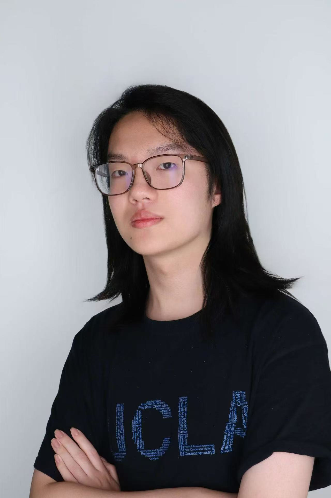

::::: {.hero}
:::: {.page-shell .hero-layout}
::: {.hero-copy}
[UCLA · Statistics and Data Science]{.hero-kicker}

# Jiahong [Chen]{.name-accent} {#jiahong-chen}
:::

::: {.portrait-frame}

:::
::::
:::::

::::: {#about .about-section}
:::: {.page-shell .about-layout}
## About me {#about-heading}

::: {.about-copy}
I’m a UCLA undergraduate pursuing a B.S. in Statistics and Data Science, with minors in Data Science Engineering and Atmospheric and Oceanic Sciences.

At Tencent Marketing Solution, I led the development and launch of a channel partner operations platform. In my research, I’ve used Python to analyze satellite waveform data and study whistler waves.
:::
::::
:::::

:::::: {#work .work-section}
::::: {.page-shell}
## Selected work

:::: {.featured-project}
::: {.project-copy}
[Product Manager Intern · June–September 2026]{.project-meta}

### Tencent Marketing Solution

I led a channel partner operations platform from concept to launch. The platform brought advertiser account management, approvals, content publishing, and reporting together for Tencent teams and agency partners.
:::

```{=html}
<dl class="project-metrics">
  <div>
    <dt>Users supported</dt>
    <dd>1,000+</dd>
  </div>
  <div>
    <dt>Product screens</dt>
    <dd>40+</dd>
  </div>
</dl>
```
::::

:::: {.project-grid}
::: {.project}
[Research Assistant · January–June 2026]{.project-meta}

### Whistler wave research

I built a resumable NASA CDAWeb download pipeline and processed about 40 GB of Cluster satellite waveform data. I automated spectrograms and comparison plots to help screen wave events.
:::

::: {.project}
[AI Application Development Intern · December 2025–March 2026]{.project-meta}

### Conversational AI at Cortelco

I built a FastAPI and Next.js interface that connects speech recognition, a language model, and text-to-speech for real-time conversations.

[View the open-source project on GitHub](https://github.com/AI-gen-e-ra-te/asrtts_v1){.project-link}
:::
::::
:::::
::::::

::::: {#education .education-section}
:::: {.page-shell .education-layout}
## Education {#education-heading}

::: {.education-details}
### University of California, Los Angeles

[B.S. in Statistics and Data Science]{.degree}

Minors in Data Science Engineering and Atmospheric and Oceanic Sciences

[Expected March 2027]{.education-date}
:::
::::
:::::
